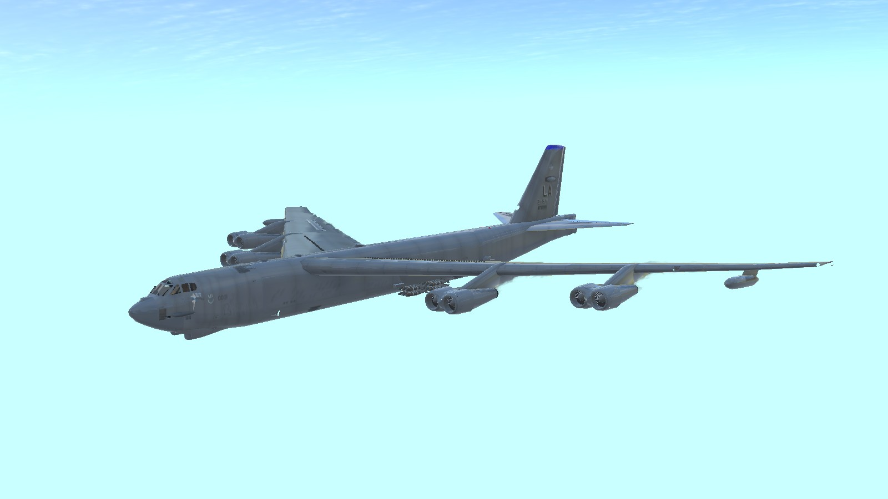
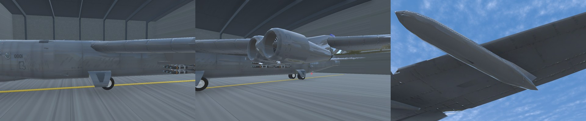
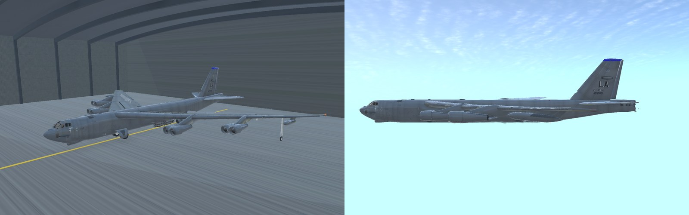
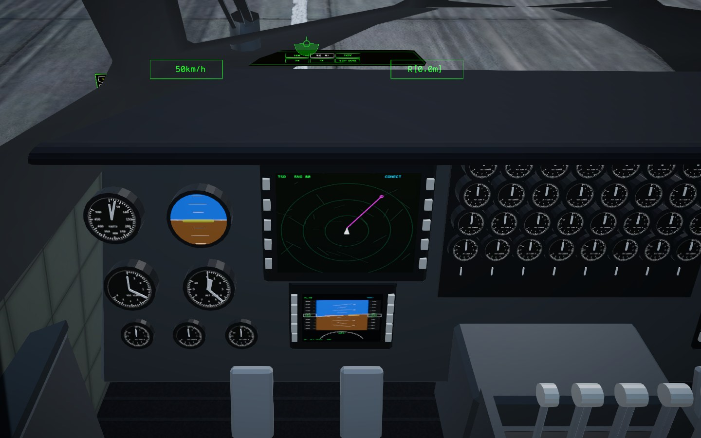

# B-52J Stratofortress for Nuclear Option

A flyable B-52 for [Nuclear Option](https://store.steampowered.com/app/2168680/Nuclear_Option/), built with
[Nikkorap's Blueprinter](https://github.com/nikkorap/NOBlueprinter-Releases/releases/latest). It uses real B-52H
airframe numbers with the B-52J modernisation: F130 engines, an AESA radar and a smart-weapon internal bay.



## Quick start
1. Install [BepInEx 5](https://docs.bepinex.dev/articles/user_guide/installation/index.html) and
   [Blueprinter](https://github.com/nikkorap/NOBlueprinter-Releases/releases/latest) 2.0.1 or newer.
2. Download `B-52J-Stratofortress_<version>.zip` from [Releases](https://github.com/IornMan1213/NO-B52/releases).
3. Delete any older `B-52J Stratofortress_*.nobp` from `BepInEx/plugins` (or the old `B-52J_Stratofortress` folder),
   make a folder `Nuclear Option/BepInEx/plugins/B52J/` and extract the zip into it. You should have the `.nobp`
   and `B52Systems.dll` in that folder; the game needs both. (The zip has the same layout as the mods the NOMM mod
   manager installs, so it can install it the same way once the B-52 is listed.)
4. Recommended: [Heavy Aircraft Hangar](https://github.com/IornMan1213/NO-HeavyHangar). The B-52 is too big for
   stock hangars; Heavy Hangar adds a hangar it fits in at bases with a long runway. Without it, the B-52 spawns on
   the apron outside the hangar.

In multiplayer, every player needs the same version.

## Features
- **Flight model tuned to the real aircraft.** Full-load takeoff run of about 2,300 m, lifting off at about 170 kt
  without rotating. Climbs above 42,000 ft and cruises at Mach 0.70-0.75. Transonic drag rise, so it can't go
  supersonic in a dive. Fly-by-wire tuned for a bomber, not a fighter.
- **Landing gear modelled on the B-52H.** Four two-wheel main trucks and two wingtip outriggers. Each truck swivels
  90° and folds flat into its own well, and the doors are cut from the skin so they close flush.
  **Crosswind crab:** turn all four trucks up to 20° to land crabbed into the wind.
- **Landing aids.** Speedbrakes (spoilers) at idle, and a 44 ft drag chute on the runway.
- **Flight deck** with pilot and co-pilot seats, working standby instruments, engine displays and the tactical map.
- **Real-world loadouts** in the internal bay and on two wing pylons: 51 Mk 82, 80 GBU-38, 24 GBU-31, 20 JASSM-ER,
  LRASM or ALCM, nuclear weapons, cluster bombs, laser-guided bombs, and **ADM-160 MALD / MALD-J decoys** that look
  like a B-52 on radar (MALD-J also jams radars near its path). Full list: [LOADOUTS.md](LOADOUTS.md).
- **Liveries and damage shading** work like stock aircraft. To paint your own, see [docs/LIVERIES.md](docs/LIVERIES.md).


*Main trucks and doors down, the forward truck under the inboard pod, and a wingtip outrigger stowed flat in flight.*


*In the Heavy Aircraft Hangar, and in cruise.*


*The flight deck, looking down at the panel (in game).

## Flying it

| | |
|---|---|
| Speedbrakes | Throttle to idle. |
| Drag chute | On the runway at idle, hold the wheel brakes below 165 kt. It drops off below 20 kt or when you add power. |
| Crosswind crab | `[` / `]` turn the main trucks 5° left or right (up to 20°), `\` straightens them. For wind from the right, crab right and keep the nose into the wind. |
| Taxi steering | Rudder (the forward trucks steer). |
| Key card | `Shift+F1` shows or hides a card with these controls. It also appears for 10 seconds on your first B-52 flight each session. |

**Numbers to fly by**
- **Takeoff:** at full load, hold it on the runway and it lifts off by itself at about 170 kt. Climb at 180 kt.
- **Approach:** about 150-165 kt, depending on weight. Flaps come out below 204 kt.
- **Touchdown:** about 135-145 kt.

## Settings
In `BepInEx/config/com.ironman1213.b52systems.cfg` (or in-game with the BepInEx Configuration Manager):

| Setting | Default | What it does |
|---|---|---|
| `Gear.CrabLeft` / `CrabRight` / `CrabCentre` | `[` `]` `\` | Crosswind crab keys. Pick others if your keyboard layout lacks these. |
| `Interface.HelpCard` | `Shift+F1` | Shows or hides the key card. |
| `Telemetry.Enabled` | off | Writes a CSV log of your own flights to `BepInEx/B52_telemetry` for bug reports (keeps the newest 20). |
| `Physics.RigidAirframe` | on | One rigid body. Off: per-part jointed physics, with visible wing flex. |
| `Debug.LogAeroCentres` | on | Logs each part's lift point when a B-52 first flies. |

## Troubleshooting
- **Two B-52s in the aircraft list, or a red error at load:** an older `.nobp` is still in `BepInEx/plugins`. Keep
  only the newest.
- **The B-52 has no spoilers, chute or crab:** `B52Systems.dll` is missing or BepInEx isn't installed.
- **It spawns outside the hangar:** that airbase has no Heavy Hangar (install it, or use a base with a long runway).
- **Can't taxi from an automatically placed Heavy Hangar to the runway:** a known Heavy Hangar 0.1.0 issue (the hangar
  sits on grass off the runway). Until Heavy Hangar 0.2.0, set `Placement.AutoPlace = false` in
  `BepInEx/config/com.ironman1213.heavyhangar.cfg`; the B-52 then spawns on the apron outside a stock hangar.
- **Bug reports:** turn on `Telemetry.Enabled`, fly until it happens, and attach the CSV from
  `BepInEx/B52_telemetry` and `BepInEx/LogOutput.log` to an [issue](https://github.com/IornMan1213/NO-B52/issues).

## Compatibility
| B-52J | Nuclear Option | Blueprinter | BepInEx |
|---|---|---|---|
| 0.9.0 (pre-release) | 0.34.3 | 2.0.1 or newer (tested on 2.1.1) | 5.4.23 |

Changes per version: [CHANGELOG.md](CHANGELOG.md).

## Building from source
The pipeline: bohmerang's model → Blender (split into parts, gear, cockpit, texture atlas) → Unity with the
Blueprinter Editor (prefab, weapons, `.nobp`) → the BepInEx plugin. It runs on Linux or on Windows with Git Bash.

1. Download bohmerang's model from
   [Sketchfab](https://sketchfab.com/3d-models/boeing-b-52-stratofortress-38b0c64bd552431394efa8625d7f5144) and unzip
   it into `source_assets/bohmerang/source_blend/` (you get `source/B-52.blend` and `textures/`). It is not in this
   repository.
2. Set up a Blueprinter Editor Unity project (2022.3.62f2) for the B-52; see
   [docs/FIELD_NOTE_nuclear-option-custom-aircraft.md](docs/FIELD_NOTE_nuclear-option-custom-aircraft.md).
3. Build, install (game closed) and package:

```bash
bash tools/build_all.sh
```

```bash
bash tools/install.sh b52
```

```bash
bash tools/package.sh
```

`tools/build_all.sh --from-fbx` skips Blender and builds from the committed `unity/Mods/B52/B52.fbx`. Paths default to
the usual install locations; override them with `BLENDER`, `UNITY`, `B52_UNITY_PROJECT` and `NO_GAME_DIR` (see
`tools/env.sh`). In-game test flights: [tests/ingame](tests/ingame/README.md).

| Path | What |
|---|---|
| `tools/` | Blender scripts, build, install and package scripts, flight-model checks |
| `unity/B52Tools/Editor/` | Unity builder (`B52Builder`), weapons (`B52Weapons`), inspection and render tools |
| `plugin/B52Systems/` | Runtime plugin: rigid airframe and mass, aero centres, gear and crab, drag chute, speedbrakes, transonic drag, MALD-J jammer, HUD readouts, telemetry |
| `plugin/HeavyHangar/`, `HANGAR.md` | Heavy Hangar sources, kept in step with [NO-HeavyHangar](https://github.com/IornMan1213/NO-HeavyHangar) for anyone building other large aircraft |
| `tests/ingame/` | Scripted in-game test flights (dev only) |

[MODLOG.md](MODLOG.md) records every development step, and [SPEC.md](SPEC.md) has the flight-model and loadout
numbers.

## Credits
- **Base 3D model:** "Boeing B-52 Stratofortress" by **bohmerang** on Sketchfab
  (https://sketchfab.com/3d-models/boeing-b-52-stratofortress-38b0c64bd552431394efa8625d7f5144), licensed
  [CC BY 4.0](http://creativecommons.org/licenses/by/4.0/).
  - Modified: split into parts, rescaled, rigged, and the exterior textures packed into one atlas.
  - Added: landing gear, gear doors and the flight deck interior.
- **Blueprinter** by Nikkorap.
- Built with help from Claude (AI).

## License
- **B-52 airframe model and exterior textures:** a modified version of "Boeing B-52 Stratofortress" by
  [bohmerang](https://sketchfab.com/bohmerang)
  ([original](https://sketchfab.com/3d-models/boeing-b-52-stratofortress-38b0c64bd552431394efa8625d7f5144)),
  licensed [CC BY 4.0](http://creativecommons.org/licenses/by/4.0/). The full text is in
  [LICENSES/CC-BY-4.0.txt](LICENSES/CC-BY-4.0.txt), and the changes are listed in [NOTICE](NOTICE).
- **Everything else** (code, scripts, plugins and original artwork): MIT, see [LICENSE](LICENSE).

Nuclear Option belongs to Shockfront Studios. This repository and its releases contain none of the game's files.
